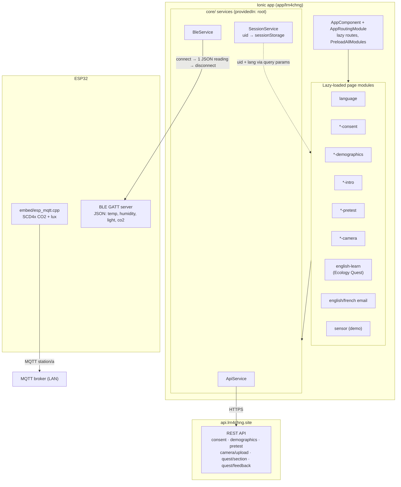

# lrn4chng — Architecture & Concept Map

Research study app (Ionic 9 + Angular 22 + Capacitor 8 + TypeScript 6) that guides
participants through a consent → demographics → pretest → camera → learning-quest flow,
in English or French, with optional ESP32 environmental-sensor capture.

## Milestones

| Milestone | Status | Delivered |
|---|---|---|
| M1 — High-level structure | ✅ done | `core/` services layer (`api.ts`, `sensors.ts`, `session.ts` + fixed specs), 11 imports migrated; real Capacitor appId (`site.lrn4chng.app`); ESP32 credentials extracted to git-ignored `esp_mqtt_config.h`; broken page specs repaired (17/17 tests green); this document |
| M2 — Demographics update | ✅ done | "Are you from Le Mans University?" boolean replaced with required free-text **Affiliation — University or Company** (`affiliation`); app form, `core/api.ts` payload, `serve/` Pydantic schema and Mongo storage key all swapped together |
| M4 — Intro heading | ✅ done | `english-intro` hero: "Your Learning Journey" heading removed; the subheading is promoted to the main `<h2>` (inherits hero heading style) |
| M5 — Country as text input | ✅ done | `english-demographics`: Native Country action-sheet `ion-select` replaced with a free-text `ion-input` (required only); unused `countries` list and select styling removed. No payload/backend change (`nativeCountry` stays a string) |
| M6 — Quest section/feedback API | ✅ done (repo) / ⏳ deploy | Root cause of the `/quest/section` 404s: endpoint never existed on the live server (old code had been redeployed after the import crash). `serve/app/routes/quest.py` now serves sanitized `GET /quest/section` and grades `POST /quest/feedback` server-side; `store_quest_progress` added to `database.py`; legacy `GET /quest` sanitized too; client guards against non-numeric section ids. Smoke-tested in-process (TestClient). Pending: redeploy `serve/` |
| M7 — Section 5 → two MCQ tiers | ✅ done (repo) / ⏳ deploy | Old textarea §5 replaced by §5 (Tier 1: winter CO₂ in cities — correct **C** "They increase") and §6 (Tier 2: why — correct **B** heating + reduced photosynthesis); old §6/§7 renumbered to 7/8, `totalSteps` 7→8; learn template's hardcoded id checks updated to 7/8. Backend smoke tests + app build/tests green |
| M8 — Pretest tiers + learn flow + attempts | ✅ done (repo) / ⏳ deploy | (1) q7/q8 tier MCQs added to `english-pretest` (Not Sure → −1), backend `/pretest` now requires exactly 8 answers, stored as `pretest_answers` as before; (2) learn §5 Continue enabled regardless of correctness; (3) "continue or finish?" note + Finish button now on §6/§7/§8; (4) every `/quest/feedback` appends 1/0 to `attempts.<sectionId>` on the uid doc (`[0,0,1]` semantics; binary sections record 1). Verified with fake-Mongo TestClient + app tests |
| M9 — Quest storage: one doc per uid | ✅ done (repo) / ⏳ deploy | `quest_progress` simplified to a single document per uid with `section_<id>` subdocuments `{answer, is_correct, attempts, clicks_count, continue_at, first_attempt}` (no events array, no attempts map, no text_input/viewed_at/all_responses). `first_attempt` = grade of first submission, never overwritten. Verified with fake-Mongo TestClient. After deploy, drop legacy data once: `db.getSiblingDB("test").quest_progress.drop()` (dev phase) |
| M10 — Gate Continue/Finish on correct answer | ✅ done (repo) | Learn page: new `canProceed(state)` helper — single-select sections (except §5, which always passes per M8) only show Continue/Finish when `feedback.isCorrect`; the choice-note on §6/§7/§8 is gated the same way. Binary sections unchanged (no wrong answer exists). Previously §6/§7 showed Finish even on a wrong answer |
| M11 — JSON quest content + rounds | ✅ done (repo) / ⏳ deploy | Quest content moved to `serve/app/data/quest_round1.json` / `quest_round2.json` (same schema, loaded + validated at startup). Round resolution: explicit `?round=` param → else deterministic `sha256(uid) % 2 + 1`; logged as `round` on the uid's quest doc. App: `/english-learn-2` route reuses the learn module with `data: {round: 2}`; page forwards `round` on section/feedback calls. Grading is per-round; payloads stay sanitized |
| M12 — One quest doc per (uid, round) | ✅ done (repo) / ⏳ deploy | `quest_progress` upsert key changed from `{uid}` to `{uid, round}`: a participant doing both rounds gets a separate document per round, so round 1 logs are never overwritten by round 2. Verified with fake-Mongo TestClient (same uid, both rounds → 2 independent docs) |
| M13 — Decide page | ✅ done (repo) | New lazy `decide` route: "You did well 🎉" + "Learn Something Else" (→ `english-learn-2`, hidden when `round=2`) and "Move to Feedback" (placeholder toast — no feedback page yet). Learn page `finishQuest()` now navigates to `/decide?uid&lang&round` instead of the dead `/summary` |
| M14 — Round-2 auto-scroll fix | ✅ done (repo) | `scrollToSectionElement` used document-global `getElementById`, which matched the round-1 page's elements still kept in the DOM by `ion-router-outlet` — so round 2 never scrolled. Now uses component-scoped `@ViewChildren('sectionEl')` lookup with the same smooth-scroll/fallback behavior |
| M15 — In-place single-select feedback | ✅ done (repo) | Selecting an option now swaps the options out in place: spinner → feedback box (no scrolling). Wrong answers get a "Try Again" button that restores the options (clears feedback + stale highlight) so the user can pick the correct one; correct answers keep the existing Continue/Finish flow. Every attempt is still POSTed to `/quest/feedback` (attempts/first_attempt stay accurate). Covers both `english-learn` and `english-learn-2` (shared component) |
| M16 — Decide: block next-quest when done | ✅ done (repo) | "Start another learning quest" is no longer hidden for round-2 users — it's shown **grayed out and unclickable** with a "You've completed all available learning experiences 🎉" note. `TOTAL_LEARNING_EXPERIENCES = 2` on `DecidePage` controls it (bump to 3 when english-learn-3 exists); the next-quest route is now dynamic (`/english-learn-${round + 1}`) |
| M17 — Decide stale-instance fix | ✅ done (repo) | Ionic's router outlet **reuses** the DecidePage instance when navigating to `/decide` a second time (round-1 → round-2 loop), so `ngOnInit` never re-ran and the page kept `round = 1` — the next-quest button stayed active. Param reading moved to `ionViewWillEnter()` (fires on every page entry, reused instances included) |
| M18 — Decide heading guidance note | ✅ done (repo) | Hero card shows a note when the next-quest card is grayed (`!hasNextExperience`): the "not clickable" state means all quests are done — proceed to Feedback. Hidden for round-1 users (button still active there) |
| M19 — Post-test page + API | ✅ done (repo) / ⏳ deploy | New `post-test` page (copy of pretest with **q7/q8 tier questions removed** → 6 items, q1–q4 TF + q5–q6 MCQ) and `POST /posttest` FastAPI route storing `posttest_answers` (6 scores) on the **same per-uid document** as the pretest. Flow: decide "Finish and go to Feedback" → `/post-test` → submit → success state (feedback form is a future milestone). Backend verified with fake-Mongo TestClient (6 → 201, 8 → 422, same-uid doc holds pre+post) |
| M20 — Cognitive Load questionnaire | ✅ superseded by M23 | (Original single-page 15-item version, replaced by the 3-page design in M23) |
| M22 — CLT text labels | ✅ superseded by M23/M24 | (Text-option rows, then top legend — replaced by M24's per-question end-labels) |
| M23 — CLT: 3 pages × 5 questions | ✅ done (repo) / ⏳ deploy | CLT split into `/english-clt` (ICL 1–5) → `/english-clt-2` (ECL 6–10) → `/english-clt-3` (GCL 11–15), one shared component with `data: {part}`. No "Cognitive Load"/construct titles shown; numeric 1–5 pills. **Per-part submission**: `POST /clt` now takes `{uid, part, answers(5×1–5), language}` and stores `clt_answers_icl`/`_ecl`/`_gcl` (5 each) on the same per-uid doc as pre/post. Verified with fake-Mongo TestClient |
| M24 — CLT: end-labels under pills | ✅ done (repo) | Small-font end-labels **below** each question's 1–5 pill row — "Strongly Disagree" (left) and "Strongly Agree" (right) |
| M25 — CLT: top legend + progression arrow | ✅ superseded by M26 | Legend kept, but the gradient progression bar/arrow was removed in M26 |
| M26 — CLT refinements | ✅ done (repo) | Progression bar/arrow removed (legend items remain at top); question text is now **bold** (`.item-text` font-weight 700); per-question end-labels from M24 ("Strongly Disagree" under pill 1, "Strongly Agree" under pill 5) kept |
| M27 — CLT: semantic color scale | ✅ done (repo) | Likert colors: 1 red (#d32f2f), 2 orange (#f57c00), 3 yellow (#fbc02d), 4 light green (#7cb342), 5 dark green (#1b5e20). Top-legend circles use their colors; a slim 5-segment color band sits under each question's pill row (before the M24 end-labels). Numeric submission and backend untouched |
| M28 — IMI questionnaire (17 items, 3 pages) | ✅ done (repo) / ⏳ deploy | `english-imi` / `-2` / `-3` (shared component, `data: {part}`): Interest/Enjoyment (1–5) → Competence (6–10) → Value/Usefulness (11–17). Same CLT design (bold colored legend, 1–5 pills, color band, end-labels, bold questions). Per-part `POST /imi` with per-part length validation (5/5/7) stores `imi_answers_interest`/`_competence`/`_value` on the same per-uid doc. CLT part 3 hands off to IMI; IMI part 3 shows the completion state (feedback form pending) |
| M29 — english-thank closing page | ✅ done (repo) / ⏳ deploy | New `english-thank` page: optional open-text opinion + required yes/no "willing to contribute further" (branch message shown on selection: yes → "we will contact you via email", no → "thank you for your participation"). `POST /thank` stores `thank_opinion` + `thank_willing` on the same per-uid doc. IMI part 3 now routes here — this is the end of the study flow |
| M30 — Shared UI kit + loop back to language | ✅ done (repo) | New global `src/theme/shared-ui.scss` (imported in `global.scss`) holds the shared `.hero-card`, `.instructions-box`, `.form-card`, `.req`, `.form-row`, `.custom-input`, `.input-group`, `.custom-segment`, `.action-footer`; duplicated copies removed from demographics/pretest/post-test/intro/decide/thank/clt/imi page styles (page-specific styles stay local). Pretest/post-test's light hero variant standardized to the gradient hero. After `english-thank` submits, the app clears `app_uid` and routes back to `/language` for the next participant |
| M31 — About text on intro | ✅ done (repo) | `english-intro` gains an "About this study" card (shared `.form-card`) between the hero and the progress tracker, with the researcher/study description text verbatim; small local `.about-text` paragraph spacing |
| M32 — Interactive research consent form | ✅ done (repo) / ⏳ deploy | `english-consent` redesigned: shared hero + scrollable consent text (verbatim study wording) with **auto-filled date** (`{{ today }}`), key-point callouts (1-year retention, deletion rights via imran.khan@univ-lemans.fr, consent-form email copy), email field, and **three required checkboxes** (read / understood / approved). Backend: consent doc in `test.testdb` now also stores `consent_date`; email was already stored with the uid. Actual SMTP sending of the consent form is NOT implemented (needs mail credentials) — UI states it will be sent |
| M33 — Hard refresh after last page | ✅ done (repo) | After `english-thank` submits: clears `app_uid` (sessionStorage) **and** `app_language` (localStorage), then `window.location.assign('/language')` — a full reload, so no previous participant data survives in memory/cache. Unused router/toast injections removed |
| M34 — Per-option feedback | ✅ done (repo) / ⏳ deploy | Every MCQ option in `quest_round1/2.json` now carries its own `feedback {header, message}` (correct option = praise, each wrong option = a specific hint); the old section-level `correct`/`incorrect` pair was removed. `/quest/feedback` grades via `isCorrect` and returns the **picked option's own** feedback; public section payloads remain sanitized (`text` only). Client unchanged (`FeedbackResponse` shape identical) |
| M35 — HMAC-signed API | ✅ done (repo) / ⏳ deploy + secret setup | Every request carries `X-Api-Timestamp` + `X-Api-Signature` = hex HMAC-SHA256(secret, `ts\nMETHOD\npath\nsha256(body)`); server (`app/auth.py`, global dependency in `main.py`) verifies with constant-time compare and a ±5 min replay window — **all routes signed incl. /health and /**; multipart camera upload signs with empty body hash. Client: `apiSecret` in environments (prod value injected at build time, never committed); `API_SECRET` env on server via git-ignored `serve/.env`. Caveat: embedded secret = tamper-evidence, not real auth |
| M3 — Backend sync | ⏳ next | Redeploy `serve/` to `api.lrn4chng.site` (M6 code) and verify live endpoints with curl |

## Repository layout

```
lrn4chng/                          (git root)
├── AGENTS.md                      agent conventions
├── docs/ARCHITECTURE.md           this document
├── embed/                         ESP32 firmware (Arduino/C++)
│   ├── esp_mqtt.cpp               sensor station: SCD4x CO2 + B_LUX_V30B light → MQTT
│   ├── esp_mqtt_config.h          real credentials  (git-ignored, never commit)
│   └── esp_mqtt_config.example.h  template to copy
└── app/lrn4chng/                  the Ionic app
    ├── capacitor.config.ts        appId: site.lrn4chng.app, webDir: www/
    ├── angular.json               build output → www/
    └── src/
        ├── app/
        │   ├── core/              shared services layer (single source of truth)
        │   │   ├── api.ts         ApiService + all payload/response interfaces
        │   │   ├── sensors.ts     BleService + SensorData (one-shot BLE reading)
        │   │   └── session.ts     SessionService (uid in sessionStorage)
        │   ├── home/              landing page
        │   ├── language/          EN/FR selector → /{english|french}-consent
        │   ├── sensor/            BLE sensor demo page
        │   ├── english*/          English study stages (email, consent, demographics,
        │   │                      intro, pretest, camera, learn) + english/ (email page)
        │   ├── french*/           French stages (email, consent, demographics, intro)
        │   ├── app.module.ts      NgModule bootstrap (standalone: false everywhere)
        │   └── app-routing.module.ts   all routes, lazy-loaded, PreloadAllModules
        ├── theme/variables.scss
        └── global.scss
```

## Concept map



## Study flow and routes

Active participant flow (language choice drives the `{en|fr}` prefix):

```mermaid
flowchart LR
    L["language"] -->|"en"| C["english-consent"]
    L -->|"fr"| CF["french-consent"]
    C --> I["english-intro"] --> D["english-demographics"] --> P["english-pretest"]
    P --> K["english-camera"] --> Q["english-learn"] --> S["decide"]
    S -->|"Learn again"| Q2["english-learn-2 (round 2)"] --> S
    S -->|"Feedback (via post-test)"| PT["post-test<br/>6 items (no tiers)"] --> C1["english-clt (ICL 1–5)"] --> C2["english-clt-2 (ECL 6–10)"] --> C3["english-clt-3 (GCL 11–15)"] --> I1["english-imi (Interest 1–5)"] --> I2["english-imi-2 (Competence 6–10)"] --> I3["english-imi-3 (Value 11–17)"] --> T["english-thank"] --> L
```



| Route | Module | Purpose |
|---|---|---|
| `''` | — | redirect → `language` |
| `language` | LanguagePageModule | EN/FR cards; persists `localStorage('app_language')`; haptics + toast |
| `{en\|fr}-consent` | *ConsentPageModule | consent form → `POST /consent` |
| `{en\|fr}-intro` | *IntroPageModule | study introduction |
| `{en\|fr}-demographics` | *DemographicsPageModule → `POST /demographics` | age, gender, major, GenAI familiarity… |
| `{en\|fr}-pretest` | *PretestPageModule → `POST /pretest` | pretest answers |
| `{en\|fr}-email` | *EmailPageModule | alternate email entry (currently bypassed by the flow above) |
| `english` → `page` / `consent` | EnglishPageModule | email page + **its own** consent child route (separate component from top-level `english-consent`) |
| `english-pretest` → `english-camera` | | camera photo → `POST /camera/upload` |
| `english-learn` / `english-learn-2` | EnglishLearnPageModule | quest: `GET /quest/section` per step, `POST /quest/feedback`; `-2` variant carries `data: {round: 2}` (same component) |
| `decide` | DecidePageModule | post-quest: "You did well 🎉" + two choices — "Learn Something Else" → `english-learn-2` (hidden when `round=2`) and "Move to Feedback" (toast placeholder) |
| `sensor` | SensorPageModule | BLE demo (one-shot ESP32 reading) |
| `home` | HomePageModule | landing page |

`uid` (hash returned by the email API or consent flow) and `lang` travel between pages
as **query params**, mirrored in `sessionStorage('app_uid')` by `SessionService`.

## Backend contract (`src/app/core/api.ts`)

Base URL: `https://api.lrn4chng.site`

| Call | Method | Notes |
|---|---|---|
| `/consent` | POST | uid, accepted, email, language |
| `/demographics` | POST | uid, age, gender, status, majorOrProfession, **affiliation** (free text, required), genAiFamiliarity, nativeCountry, language |
| `/pretest` | POST | uid, answers[] (**8 entries**: 1/0, −1 = not sure), language → returns `image_url`; stored as `pretest_answers` |
| `/camera/upload` | POST | multipart: uid + file |
| `/quest/section` | GET | sectionId, uid, language → one section (binary / single-select / textarea) |
| `/quest/feedback` | POST | uid, sectionId, timestamp, clicksCount, selectedOption/textInput, round → server decides `isCorrect` + feedback text; upserts subdocument `section_<id>` on the doc keyed `{uid, round}`: `{answer, is_correct, attempts, clicks_count, continue_at, first_attempt}` (`first_attempt` set from the grade of the first submission only). One doc per (uid, round), so rounds never overwrite each other |

The quest is **server-driven**: the client never knows correct answers; sections and
feedback both come from the API.

## Sensor paths (two coexisting approaches)

1. **In-app BLE** (`core/sensors.ts`): scan by service UUID → connect → receive **one**
   JSON reading (`temperature, humidity, light, co2, status`) → stop notifications →
   disconnect. Real devices only, not browser/simulator.
2. **MQTT firmware** (`embed/esp_mqtt.cpp`): standalone ESP32 publishes SCD4x CO2 +
   lux readings to topic `station/a` on a LAN broker. Credentials live in
   `embed/esp_mqtt_config.h` (git-ignored; copy from `esp_mqtt_config.example.h`).

## Backend (`serve/` — FastAPI, committed in `780159d`)

Python 3.12 + uvicorn behind Traefik (TLS, `Host(api.lrn4chng.site)`); MongoDB 8 + Redis 8
on a private Docker network; camera uploads served back via `/images` static mount.
Endpoints: `POST /email` (sha256 → uid), `/consent`, `/demographics`, `/pretest`,
`/camera/upload`, `GET /quest?round=`, `GET /quest/section`, `POST /quest/feedback`,
`GET /health/{mongo,redis}`. Quest content is data-driven: `app/data/quest_round1.json`
+ `quest_round2.json`, loaded at startup; each uid gets a round (explicit param or
sha256-derived) logged as `round` on their `quest_progress` doc. Separate `serve/mqtt/`
compose runs Mosquitto for the ESP32 firmware.

**Deployment state (as of 2026-11-06):** the live server was running a newer
`quest.py` that crashed at startup (`from database import store_quest_progress` —
wrong; correct form is `from app.database import …`), so it had been redeployed from
the old code and `/quest/section` + `/quest/feedback` returned **404** while the app
already called them. Fixed in the repo by M6: `quest.py` now implements both endpoints
(server-side grading, answers/feedback never sent to clients), `database.py` has
`store_quest_progress`, and the duplicate `get_quest` was removed.
After redeploying the M6–M8 code, the live `/openapi.json` shows the quest endpoints
and `affiliation` — but **`POST /pretest` is still missing on the server (404)**, even
though the repo's `main.py` registers it (`app.include_router(pretest_router)`).
Conclusion: the deployed image is not built from this repo — **rebuild and redeploy
`serve/` from the current working tree**, then verify `/openapi.json` lists `/pretest`
and `POST /pretest` returns 201.

## Conventions

- **Shared UI kit** (`src/theme/shared-ui.scss`, imported from `global.scss`): `.hero-card`, `.instructions-box`, `.form-card`, `.req`, `.form-row`, `.custom-input`, `.input-group`, `.custom-segment`, `.action-footer`. Pages use these classes instead of redefining them; page SCSS only holds page-specific styles. Note: pretest/post-test previously used a light hero variant — standardized on the gradient hero in M30.
- NgModule-based pages (`standalone: false`), one `*.module.ts` + `*-routing.module.ts`
  per page; lazy loading via `loadChildren: () => import(...)`.
- Angular control flow `@if` / `@for` (not `*ngIf`/`*ngFor`) and `inject()` over
  constructor injection — enforced by `@angular-eslint`.
- Strict TypeScript (`strict: true`, `strictTemplates: true`).
- Tests: vitest, specs colocated next to sources.

## Known gaps (tracked for later milestones)

- Live backend drift: M6 quest endpoints are implemented in the repo but **not yet
  deployed** — `api.lrn4chng.site` still 404s `/quest/section` until `serve/` is redeployed.
- Feedback form does not exist yet — the flow now ends at `english-thank`
  (open-text opinion + willingness to contribute, stored via `POST /thank`).
- ~~`/summary` — learn page navigates here but no route/module exists yet.~~ Resolved in
  M13: Finish now leads to the `decide` page.
- French parity stops after intro (no french-pretest / camera / learn).
- Two consent implementations exist (top-level `english-consent` module vs child route
  inside `english`); the active flow uses the top-level one.
- Email page (`english/page`) is currently bypassed by the language → consent flow.
- `english-learn.page.ts` still uses constructor injection (lint prefers `inject()`).
- Debug `console.log` output in `core/api.ts` and learn page.
